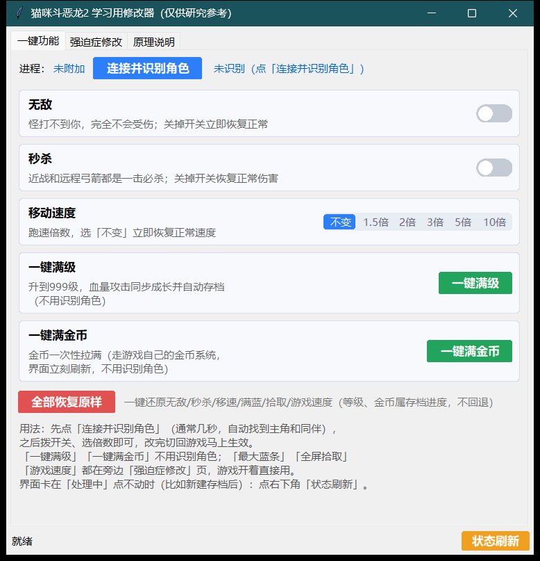
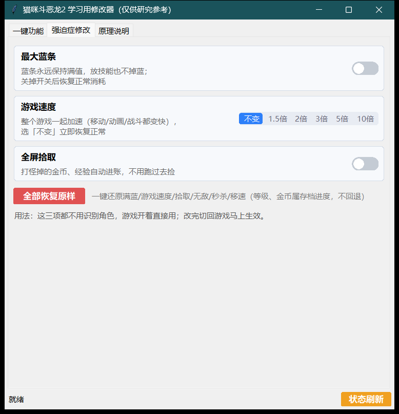
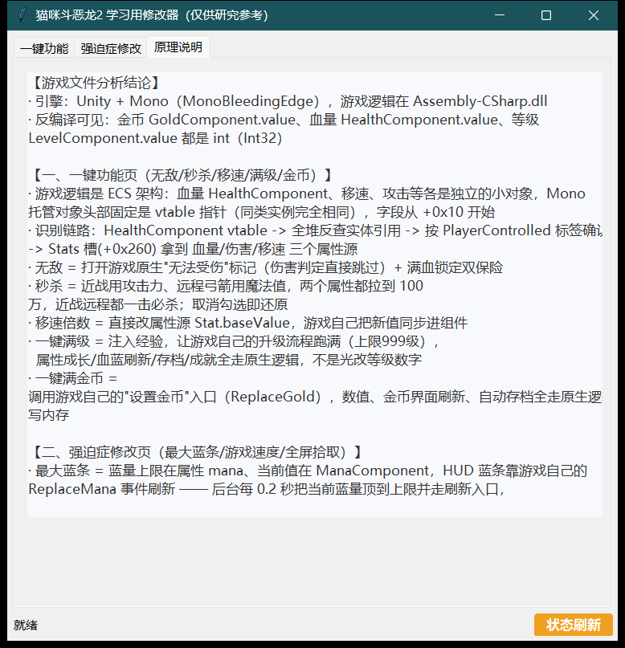

# 猫咪斗恶龙2修改器

《猫咪斗恶龙2》（Cat Quest II，GOG 版）Windows 单机学习用图形界面修改器，仅供个人单机研究使用。

## 功能

**一键功能页**

- 连接并识别角色（走游戏内部接口，秒级定位主角和同伴）
- 无敌 / 秒杀开关
- 移动速度倍数（不变 / 1.5 / 2 / 3 / 5 / 10 倍，分段选择带滑动动画）
- 一键满级、一键满金币（无需识别角色）
- 全部恢复原样

**强迫症修改页**

- 最大蓝条（蓝量永远保持满值，技能无消耗）
- 游戏速度倍数（整个游戏一起加速）
- 全屏拾取（掉落的金币、经验自动进账）

**其他**

- 右下角「状态刷新」：界面卡住时一键恢复并重新识别
- 圆角 UI 设计，整窗圆角

## 界面截图







## 使用方法

1. 打开游戏并进入可操作角色的画面
2. 下载 Release 里的 `CatQuestII-Trainer.exe`（即猫咪斗恶龙2修改器）双击运行；或源码方式运行 `启动修改器.bat`
3. 点「连接并识别角色」（通常几秒完成）
4. 拨开关、选倍数，改完切回游戏立即生效

## 打包源码运行

需要 Python 3.11+：

```powershell
python catquest_trainer.py
```

## 免责声明

仅供个人单机学习研究使用，请勿用于联机或商业用途。使用本工具产生的任何后果与作者无关。
